# The world

What the open world is made of, as of 2026-10-21: how it is built, the
districts, the landmarks placed in it, the experiments behind switches, and
the lab's catalogue of patterns not yet placed. Each district and landmark
has a picture and a camera position to visit it. The chasm is a separate
mode (`--opt chasm`) and is listed only briefly.

The world is a 16 km square that wraps at its edges.

## Maps

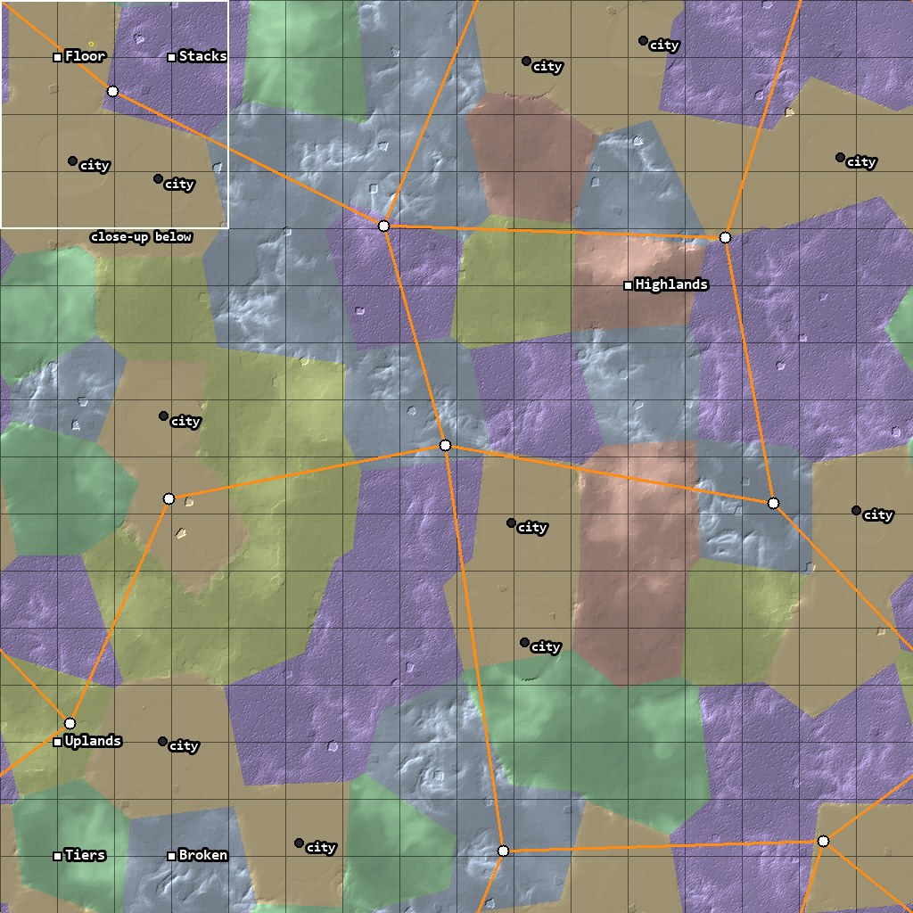

The whole world, 16 m a pixel, north (−z) up, a 1 km grid. Tinted by
district: **Floor** tan, **Tiers** green, **Stacks** purple, **Broken**
blue-grey, **Uplands** yellow-green, **Highlands** salmon. Orange lines are
canals, white discs their stations. Squares mark the district views below;
dots the hanging cities. The world wraps, so the Tiers, Broken and Uplands
views at the bottom left are only 2–4 km from the start at the top left.

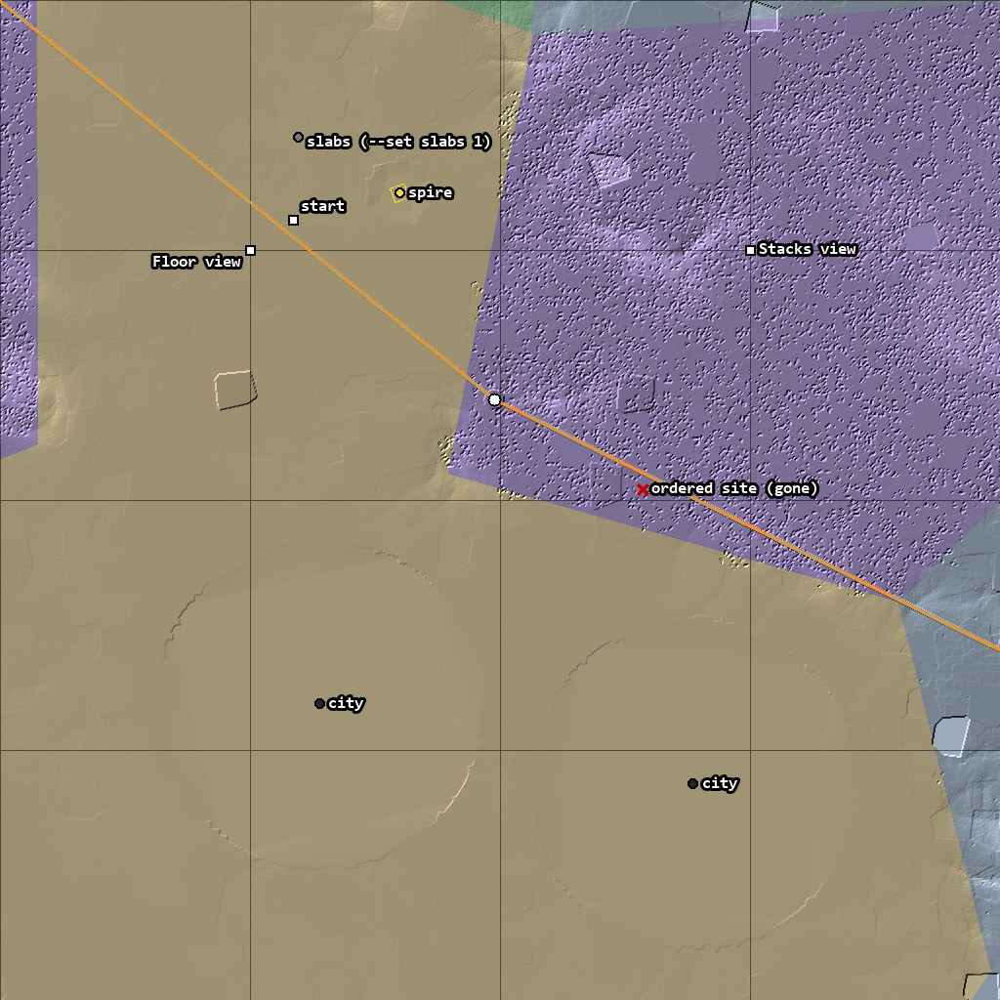

The start corner close up (0–4 km, 4 m a pixel), where most landmarks are.

Redraw the map with `cargo run -p worldgen --release --example map --
out.png 16` (metres a pixel); it also lists the stations, sites and colossi.

## How it is built

The ground is built in layers, each deciding one thing:

1. **The landform: one height field for the whole world.** A rolling base
   (noise about 2 km across, warped by 300 m; its low half flattened to a
   quarter; up to about 90 m), plus **ridges**: ridged noise, squared, up to
   160 m, only where a second noise lets them through. It is the same
   field everywhere. Nothing in it knows about districts, except that the
   Tiers, Uplands and Highlands leave its ridges out (their plates could
   not follow them).
2. **Districts: a coarse Voronoi map (cells about 2 km).** Each district
   multiplies the landform by its **relief** (×0.04 for the Floor up to ×3
   for the Highlands) and sets the plates' rules: ledge heights, how far
   plates split, tilt, pillars, tone. Districts do not change where hills
   and valleys are, only how high they are and how they are drawn.
   Relief blends over 250 m across borders.
3. **Plates: the ground's geometry.** Flat-topped prisms in a Voronoi
   pattern at three sizes (128, 32 and 8 m apart), fitted to the shaped
   landform in flat steps (or tilted, in the Uplands and Highlands). Below
   what the geometry draws, the terrain shader carries on the same rule
   (see below).
4. **Sites and colossi: places that reshape the ground.** Each grows out of
   the plates: a flat core, terraces or an earthwork round it, its
   structure on top. Sites sit on a 768 m grid, colossi on a 2 km grid.
5. **Canals: corridors cut through everything.** They run at the broad
   height of the ground (in cuttings through high ground, on embankments
   over low ground) between stations. Sites and colossi keep clear of them,
   and are dropped if there is no room.
6. **Placed structures and experiments:** the spire from
   `data/structures.ron`; slabs and the tilted ground behind switches.

Heights now run from −21 to 206 m: half the land within a few metres of
8 m, 95% below 64 m.

**What follows from this.** The world's large-scale layout (where it rises
and falls) is one generic noise field, the same in every district. The
districts' variety is in surface and scale, not in layout. That is the
"landform sets the layout" half of the Mistlands discussion (2026-10-21):
a district with its own landform (basins, channels, crags) would be new
here. The ridged noise and its mask already exist as ingredients.

**The ground's subdivision.** Below what the geometry draws, the terrain
shader carries on the plates' own rule: a plate splits into the pieces of a
finer Voronoi diagram that fall inside it (32 m, then 8 m; 80% of pieces
split again), every piece flush but its own tone and slight tilt (the canal
stones' numbers), with a grooved joint round it (lit as a 45-degree chamfer
on either side). It gives a sense of speed without a texture: the user
judged a pattern acceptable only where it describes how the thing was
built, which the noise grain, flecks and cracks did not. The finer pieces
(2 and 0.5 m) read as painted and are off. `--opt nosubdiv` for none;
`--set subdiv_smallest` (8; 32 for the 32 m pieces only, 2 or 0.5 for the
finer ones), `subdiv_split`, `subdiv_groove`, `subdiv_tone`, `subdiv_tilt`,
`subdiv_joint`. The smallest pieces drawn are a district's own lever (the
user was torn between 8 and 32 m): 32 m in the highlands, 8 elsewhere. No
measurable cost.

## Visiting a place

    cargo run -p game --profile fast -- --cam X,Y,Z,YAW,PITCH

`Y` is metres above the ground. `YAW` 0 looks north (−z, up on the map),
90 west, 180 south, 270 east; `PITCH` is in degrees, negative looking down.
V toggles flying. `--time 60` gives a low sun, which shows slopes better.
The pictures here were taken with `--opt clean` (no gun, no notices) and
`--shot path.png`.

## Districts

Defined in `crates/worldgen/src/district.rs`. Districts span 1.5–3 km.

| District | Share | Character | Relief | Ledges | Extras |
|---|---|---|---|---|---|
| **Floor** | 26% | Vast pale flat plates, like plazas: steps of a few centimetres | ×0.04 | 0.25 m | rare mesas and pits; the hanging cities stand here |
| **Tiers** | 11% | Contour terraces: broad level treads, 2 m risers following the contours; everything is a mantle away | ×2.5, no ridges | 2 m | each plate at the land's height at its own middle; plates split only where the land rises a step across them; no mesas or pits |
| **Stacks** | 26% | Dark, dense piers and pillars on small plates | ×0.6 | 1 / 0.5 m | pillars on 18% of the finest plates (5–28 m tall) |
| **Broken** | 19% | The original broken plate terrain, a bit of everything | ×1.0 | 2 / 0.75 m | small plates, nudged; rare pillars |
| **Uplands** | 12% | Gentle rolling hills of tilted plates, level crests | ×1.5 | 1.75 m | big plates, tilted to set gradients and eight headings |
| **Highlands** | 6% | High country: tilted plates in strata, lunar ridges | ×3.0 | 1 m | no level crests; the shader's pieces only 32 m |

Measured heights by district (median, 95% below, highest), before the
Tiers were terraced: Floor 1 / 8 / 87 m, Stacks 12 / 53 / 128 m, Broken
16 / 74 / 170 m, Tiers 18 / 92 / 206 m.

**The Tiers terraced (2026-10-21).** The user could not tell the Tiers
from the Broken: half their plates split by chance, the rest wherever the
land rose 7 m across them, and each plate's height was stepped from its
parents', so they were the same jumble of small plates on a 2 m step. Now
each plate takes the land's height at its own middle, in 2 m steps, so
plates on one tread are level with each other and the risers follow the
contours (ragged by the 8 m plates). With the ridges, slopes too steep for
a tread wider than a plate broke into hex columns; without them, at relief
2.5, only the steepest patches do.

Within any district: **mesas** (raised big plates) and **pits** (sunken
ones), dark or light **marker** plates, and **pillars** grown from the
`pillar` form.

Shares are of the ground (seed 1). The district map picks floor, tiers,
stacks or broken by weight, then turns two fifths of the tiers into
highlands and of the broken into uplands. `--set district N` makes one
district everywhere (0 floor, 1 tiers, 2 stacks, 3 broken, 4 uplands, 5
highlands). Uplands and highlands have no sites or colossi yet.

### What they look like

Each view looks north at a spot deep inside a district (at least 500 m from
its border), the nearest such spot to the start.

| | |
|---|---|
| 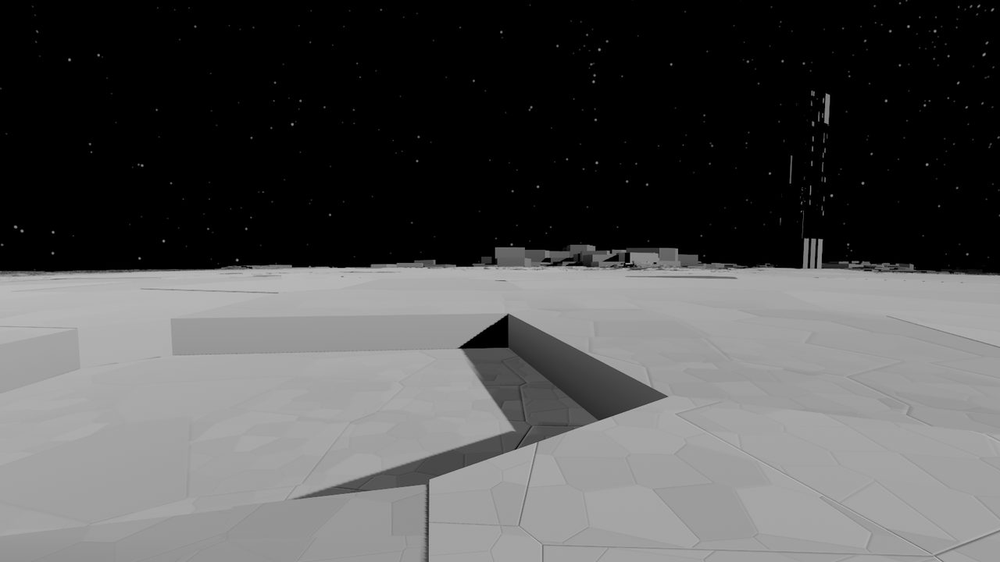 **Floor** at (1024, 1024): a pit in the flat plates; the spire and the Stacks on the horizon. `--cam 1024,25,1700,0,-4` | 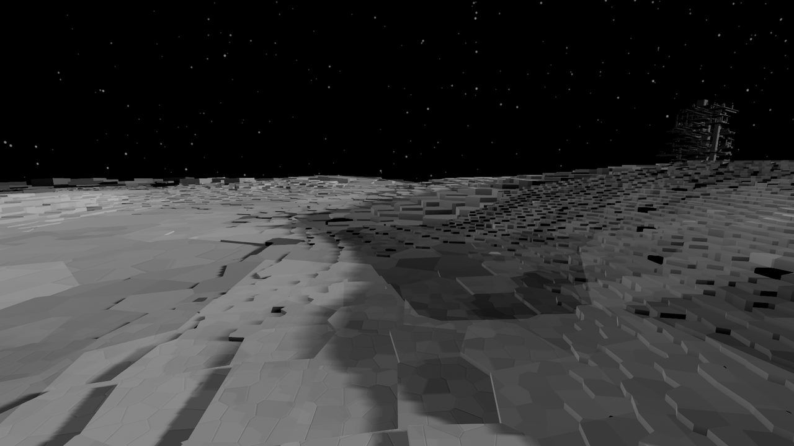 **Tiers** at (1024, 15360), low sun: contour terraces round a hill, a hanging city behind. `--cam 1024,70,15760,0,-10 --time 60` |
| 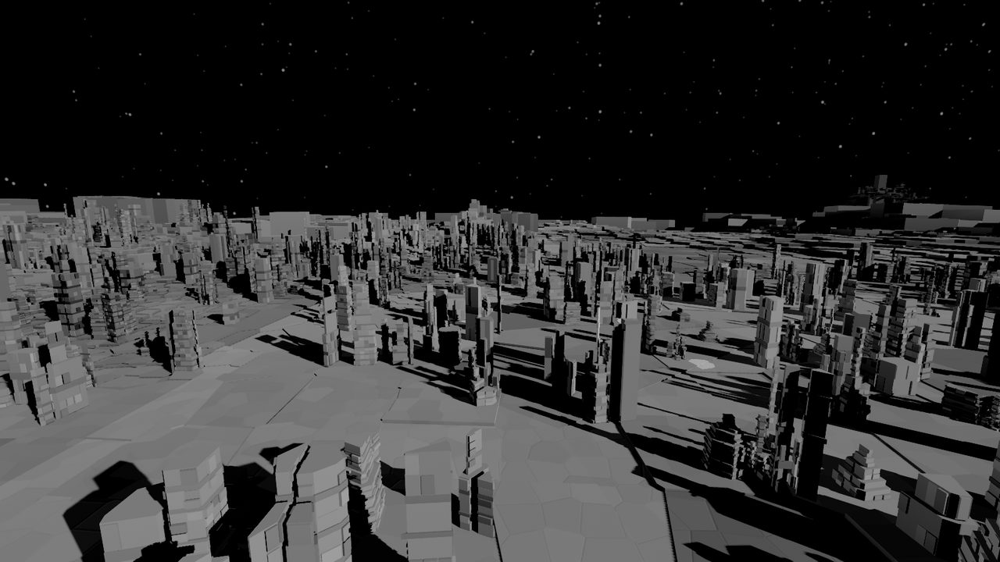 **Stacks** at (3072, 1024): pillars on small plates. `--cam 3072,60,1424,0,-10` | 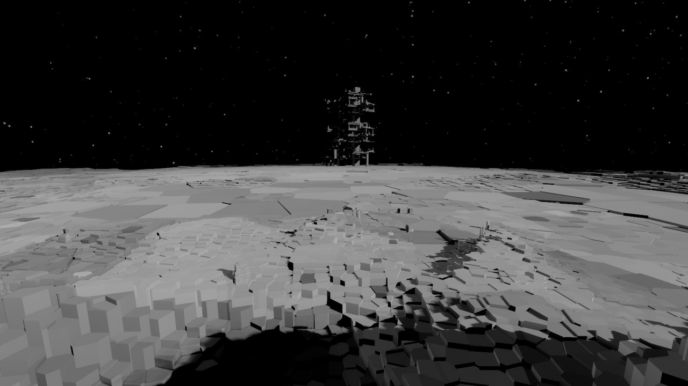 **Broken** at (3072, 15360): small nudged plates; a hanging city behind. `--cam 3072,70,15760,0,-10` |
| 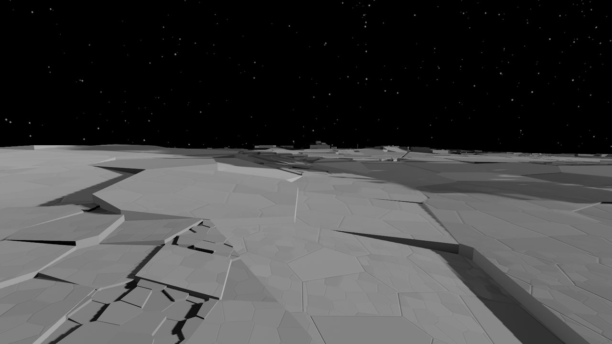 **Uplands** at (1024, 13312), low sun: big tilted plates with steps and level crests. `--cam 1024,60,13712,0,-8 --time 60` | 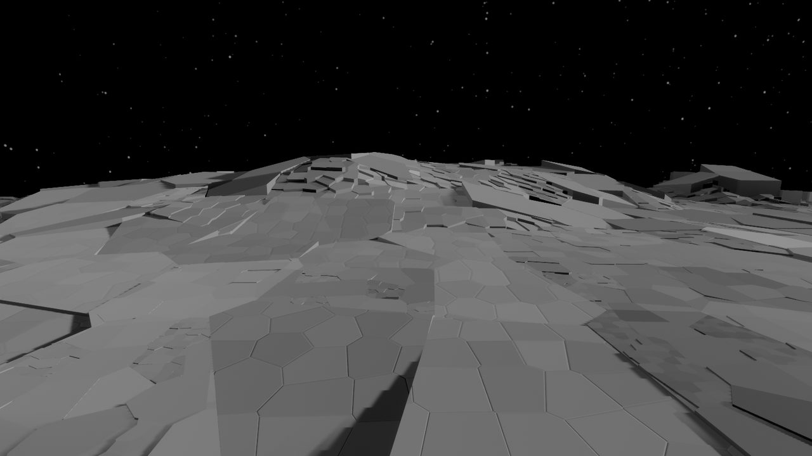 **Highlands** at (11264, 5120), low sun: tilted plates in strata over a ridge. `--cam 11264,110,5620,0,-10 --time 60` |

## Rolling terrain: uplands and highlands

Plates that tilt to follow a rolling landform (to set gradients, about
5–19 degrees, and eight headings), keeping their steps so the land reads as
built. They follow the landform without its ridges, which fade in across
their borders. They came from an experiment of three versions (big plates
with 1 m steps; 1.75 m steps and level crests; 2.5 m steps and level
crests).

**The user's findings (2026-10-17), which made the two districts:**
- Version 2 works better for reliefs 1 to 2 (now the uplands); version 1
  works better for reliefs 3 and up (now the highlands).
- These variants suit the terrain of biomes: kinds of land that districts
  are made from, alongside Floor, Tiers, Stacks and Broken.
- Small plates with big steps read as the Broken district, and distant
  coarse plates as blocks of houses: rejected.
- Taller hills than the steepest tilt (19 degrees) can follow turn into
  stacked walls; steeper tilts, up to about 40 degrees (still walkable),
  are untried.
- Full daylight washes the slopes out. Judge them at a low sun
  (`--time 60`) or darker (`--set ev 12`).

## Landmarks in the open world

Set in `data/structures.ron`. Everything placed is in the start corner (see
its map above), except the hanging cities, which are spread over the Floor.

Three kinds, from three of the layers in "How it is built":

| Landmark | Layer | Reshapes the ground |
|---|---|---|
| Hanging cities | 4, colossi | yes: a low square platform with ramps |
| Canal stations | 5, canals | yes: a round court where canals meet |
| The spire | 6, placed structures | no |

Layer 4 is mostly idle: no site grows (random sites are off, and the one
placed site is squeezed out), and the only colossus rule is the hanging
city in the Floor. The Uplands, Highlands and Tiers have no sites or
colossi at all. It is the layer for new places.

| | |
|---|---|
| 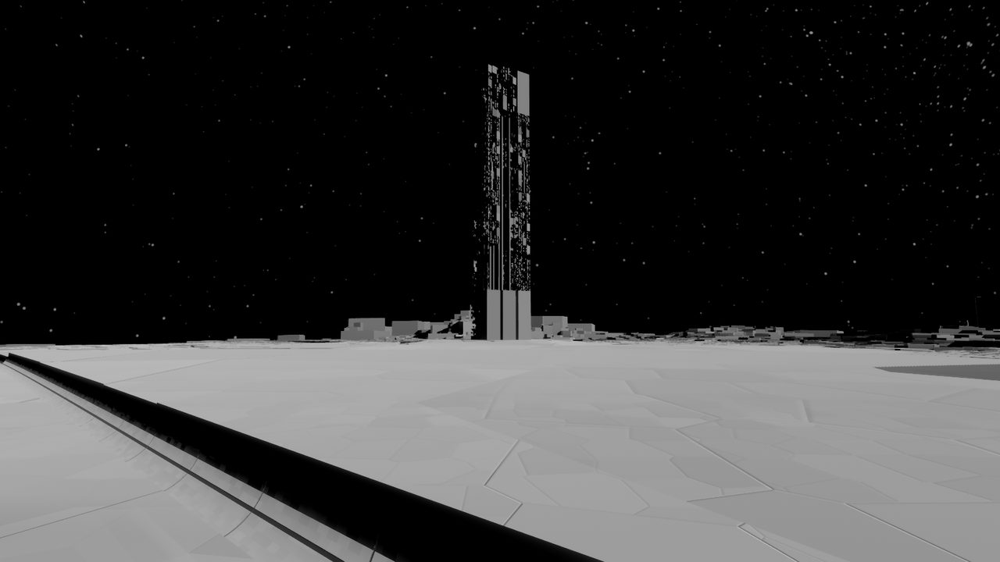 **The spire** at (1637, 791): a hand-placed structure, the `spire` box style, 60 × 340 × 60 m; a canal in front. The significant landmark (the user). `--cam 1637,15,1350,0,6` | 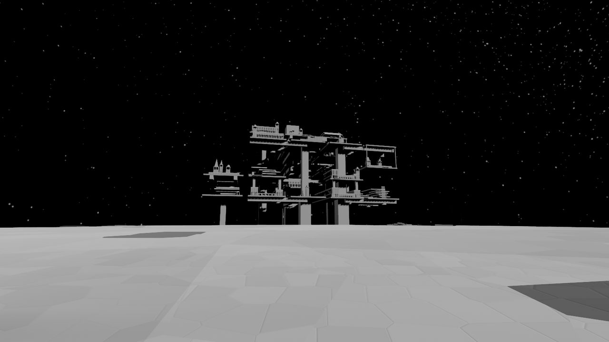 **A hanging city** at (1309, 2883): a colossus (`city_tall`) on a low platform in the Floor, 315 m tall. `--cam 1309,15,3550,0,10` |
| 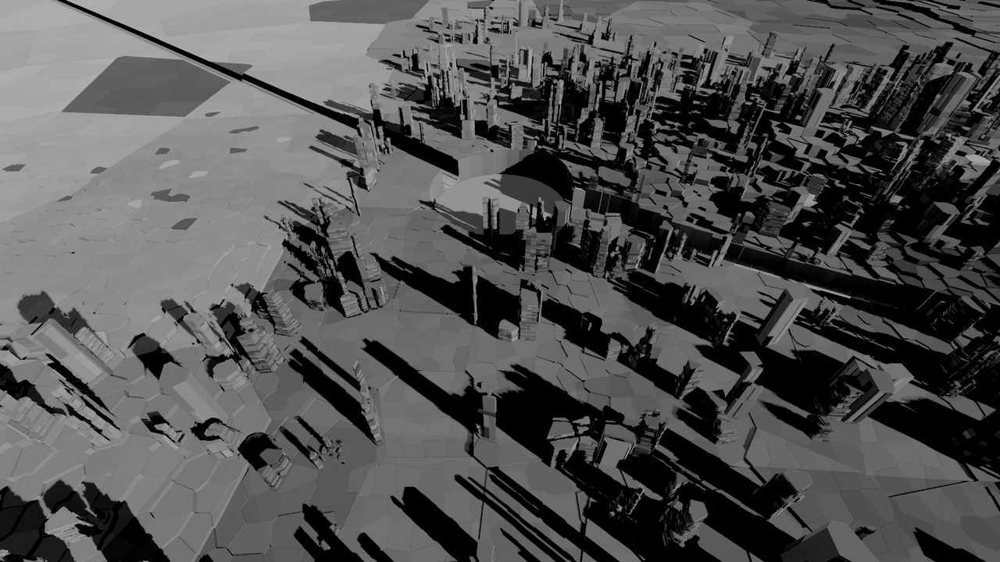 **A canal station** at (2025, 1636): a placeholder round court where canals meet, at the edge of the Stacks. `--cam 2025,140,1850,0,-45` | |

**Hand-placed structures:** the spire.

**Sites** grow out of the ground, reshaping it into a core and terraces.
The site grid is 768 m with a 55% chance per cell, but no rule picks sites
at random any more: only placed examples grow, and none does now:
- **The ordered site** at (2633, 2004): a `spire` on square terraces with
  stairs on the axes, `towers` plates around it, the seamless
  wild-to-ordered transition (see the memory on ordered transitions).
  **Gone:** a canal passes 60 m from it, which leaves it no room, and the
  generator drops it.

**Colossi**, megastructures on a 2 km grid (85% chance per cell; 11 in the
world on seed 1):
- **Hanging cities** (`city_tall`): the rule for the Floor, and every
  colossus there is. At (9445, 1101), (11542, 723), (1309, 2883), (2839,
  3211), (15077, 2824), (2942, 7471), (9168, 9379), (15369, 9154), (9413,
  11527), (2913, 13303) and (5375, 15121); 270–630 m tall.
The ordered site is still in `data/structures.ron`. To see it again, move
it clear of the canals (at least its radius plus a clearance from a canal's
centre).

**Removed 2026-10-21** (the user: the spire is the significant one; see
`docs/removed.md`): the towers on a round mound at (2698, 413), lost among
the Stacks' pillars, and the needles colossus at (2801, 834), a near-twin
of the spire; and the shattered shafts (`colossus_ruin`) at (4872, 3097),
squeezed out by a canal and not good enough to bring back (the user).

**The canal network:** 9 stations (placeholder courts) and 14 canals; see
`docs/canals.md`. Stations at (2025, 1636), (6891, 4049), (13016, 4268),
(3038, 8949), (7988, 7990), (13884, 9036), (1260, 12984), (9030, 15273) and
(14779, 15097).

## Experiments behind switches

| | |
|---|---|
| 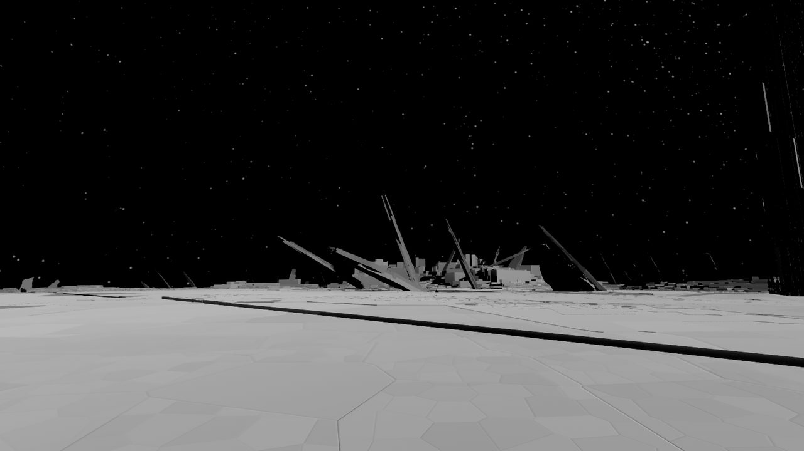 **Slabs** (`--set slabs 1`, committed): big plate cells thrust up out of the ground, tilted, in fields; monuments, after Valheim's Mistlands. A field near the start. `--set slabs 1 --cam 1220,20,1150,0,8` | 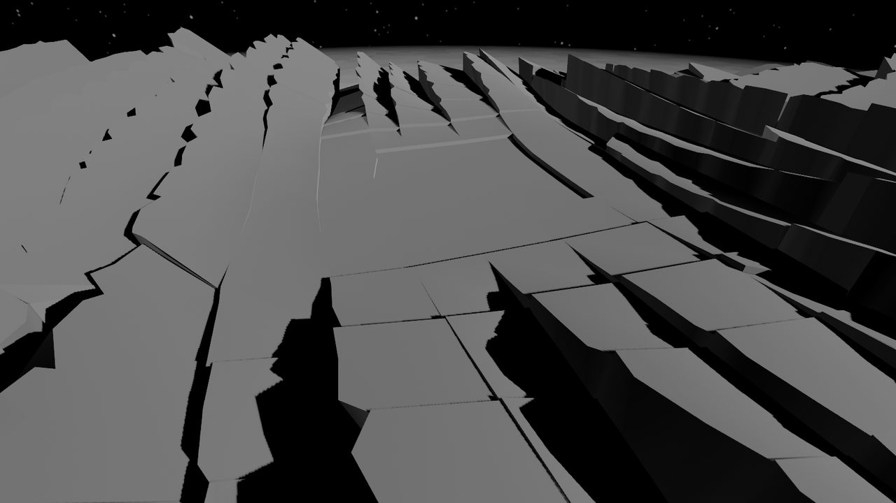 **Tilted ground** (now the ground lab's `tilted`, below): a 2 km patch where tilted sheets are the ground, with leaning escarpments and a pocket of order (a stepped bowl; this picture from before the patch was fixed at the lab's middle, where it has no pocket). `--ground tilted` |

- **Slabs** (`crates/worldgen/src/plates/slabs.rs`): kind 1, long tapering
  slabs at 20–70 degrees, 180–430 m, which the user found work as
  monuments, in a city or as landmarks in the wild. Kind 2 (`--set slabs
  2`), thick banded cliff blocks, clump as landscape; kept as the record
  until a ground made for them replaces them. The game logs the slabs near
  the start with their measures.
- **Tilted ground** (`crates/worldgen/src/tilted.rs`, in the ground lab
  as `tilted`): a lab world (the plates are replaced).
  Fault blocks of long sheets along a strike, dipping across it, half of
  them bent; escarpments leaning out over the drop; pockets of order where
  the sheets are cut into square pieces stepping down to a sunken floor.
  The user's verdict (2026-10-21): the pockets' transition works, but the
  layout stays a series of repetitive ridges. The next idea is Valheim's
  split: a landform that sets the layout, with formations placed on its
  steep ground for character.

## The ground lab

Kinds of ground made by different techniques, to find new districts by
trying techniques as well as by imagining districts (the user,
2026-10-21). `--ground NAME` replaces the world with a 2 km patch of one,
at (8192, 8192), solid to walk and fly through; `tools/grounds.ps1 [names]`
takes the same six views of each (overview, oblique, along, three at eye
level) into a contact sheet in `screenshots/grounds/`. Each technique is
cheap and rough on purpose; the code is `crates/worldgen/src/grounds/`.

| Kind | What it is | The user's verdict so far |
|---|---|---|
| `tilted` | the tilted-native ground | the reference |
| `canyons` | a plateau cut by straight-sided canyons in three levels, 70–100 m deep | what was imagined: enclosure |
| `bridged` | the canyons with levels of their own: natural bridges near the rims, grooves round the walls at shared heights (strata), the mesas' tops cut into pits with ribs between | better than what we had so far. On the way: thin planks and ledges read as bars added on; tilted tops and spires did not convince |
| `nested` | the structures' fractal rule at landscape scale: plateaus within plateaus | hints at an industrial sector, partial enclosure |
| `sunken` | the same cut downward from a 160 m plateau: pits within pits, some dropping 30–110 m, thick main ribs and thin minor ones | intriguing; from above still a grid; deep pits enclose from inside |
| `contrast` | most blocks blank, a few split all the way down (knots) | boxy, but reads as an industrial area |
| `stacked` | decks on pillars over a floor, voids between | levels as a district's identity; reads as a savanna |
| `floors` | continuous decks over many supports (cores through several levels, walls under stretches of their edges, piers and clusters, ribs under them), each level turned its own way | improved; round 3's read as trees, trunk and crown |
| `void_machine`, `void_web` | the user's: cylinders on a 150 m grid rising out of a void (the lab's ground 1.2 km down in the haze), spans collar to collar at shared levels, along the axes or also diagonal and ramped; joints defined once | looking down into the void and up from beneath the strong images; solid collars and spans read as hoops and pipes |
| `void_lattice`, `void_tension`, `void_branch`, `void_mixed` | collars and spans as members: frames within frames, bundled stays, branching struts; mixed is lattice collars with branch spans | lattice best for collars (a de Chirico hint), branch for bridges; mixed better than expected |
| `void_meander` | mixed, a darker path along each collar's members, a motif of 1, 2 or 4 bays round the ring (the user's, after the Greek meandros) | works: a weird factor that doesn't overwhelm the regular structure; patterns to tune. A technique for breaking up any regular structure |

The two axes found: **levels** (several heights under a point) as a
district's identity, not only a landmark's, and **enclosure**, full or
partial. Removed along the way (see `grounds.rs`): reaction-diffusion
labyrinths and spots, a Penrose tiling, and the void's T-square fractal
collars (in relief, as frames, as holes, as one outline band).

## The lab's catalogue, not yet placed

`--opt lab` shows these on flat ground; `--focus name` shows one. They
passed review as patterns.

| Pattern | What it is |
|---|---|
| `city_tall` | The hanging city: a sparse lattice of decks, each a composed unit (also placed, as colossi) |
| `reactor_square` | A square hanging city round a void, a reactor in it |
| `reactor_round` | The city in rings round the reactor |
| `complex_mixed` | A colossal core in a human-scale fabric, grand stairs |
| `mg_tower` | Yardstick: the Manifold Garden tower |
| `unit_plaza` | Stoas, a rotunda or tower, gateways |
| `unit_court` | Halls round a court; some with a giant loggia on top |
| `unit_terraces` | Terraces on the axis |
| `unit_gallery` | A hall, towers, a colonnade or vault |
| `unit_tower` | Towers on a podium |
| `unit_cascade` | Trays cantilevered off a solid core (after Fallingwater) |
| `unit_garden` | A pool on the axis, pergolas, pavilions, obelisks, a gateway |
| `back_plain` | Colossal wedges behind a human-scale field |
| `back_flight` | Wedges with a human-scale flight up the middle |

The building blocks behind them: box styles (`tower_block`, `slab_block`,
`lattice`, `spire`) and forms (blocks, towers, slabs, courts, daises,
pillars, crowns, ruins, terraces and the units above).

## The chasm (a separate mode)

`--opt chasm`: a floorless void with places in its walls, reached by paths
inside the rock. It has the region (`--opt region`), the room lab, and the
orb, paintings, planetarium rotundas and ichor pool among its places.

## Known issues

- **Earthwork rims: the mesh and the height function disagree.** Where a
  site's or colossus's earthwork meets the natural ground, a sloped plate's
  top is drawn as flat facets between its corners, while the height
  function (`height_at`, the walls' sampling, `--cam` placement, bots)
  follows the earthwork's smooth curve; where the curve bends the two
  differ by over 15 m (seen at the rim of the hanging city at (9413,
  11527), near (9550, 12190), in facets of 45 to 65 degrees). No holes
  come of it as far as a ray test from points on the mesh shows, but
  anything placed by height there stands inside or above the ground.
- **Holes onto the void (fixed 2026-10-18, `a4eda67`).** Walls between
  plates sampled the ground beyond them too sparsely: tilted neighbours
  and station courts were missed. A ray test (from every station's court,
  and down at a slant from 600 points standing on the mesh in the tiers,
  uplands and highlands) now finds none.
- **Holes beside pillars (fixed 2026-10-20).** A wall sampled a pillar's
  nominal top beyond it and was left out, but at full detail a pillar is
  its open form on a low base: the void showed between its slabs (the
  user's, at (16305, 16372), in a site at the world's corner; the corner
  was chance). Walls now sample a pillar's base (`PlateWorld::solid`). The
  probe: `cargo run -p worldgen --release --example holes -- X Y Z` (Y
  `auto` to stand on the ground), rays down from a spot through ground
  meshed as the game does; 462 rays through there before, none now; over
  40 spots scattered across the world, 3 rays at 2 spots remain.
- **Hairline cracks between plates.** Those 3 rays: skimming a flat top
  (at (2499, 14212), 7 cm over it), a ray slipped between two plates
  meeting at one height. Not seen in play.
- **Placed sites squeezed out by canals.** The ordered site (above)
  vanished when the canals came, without a warning, as did the shattered
  shafts (since removed). Under the fail-loudly rule a placed site with no
  room should say so.

## Removed, worth revisiting

See `docs/removed.md`: stepped ziggurat sites, racks and pipe networks,
curtains, the massif, and the stepped-mountain and walled-enclosure colossi.
